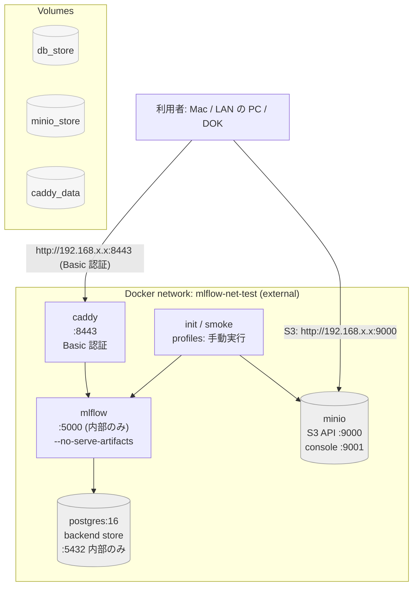

# MLflow サーバ（Mac 上の 1 個）

> このフォルダは sai-ssh の `mlflow-server/` を sai-moon に取り込んだもの（`apps/mlflow-server/`）。
> **`.env` は取り込んでいない**（鍵とパスワードが入るため）。旧フォルダで動かしていた場合は、
> `cp <旧フォルダ>/.env .env` で写してから `docker compose up -d` する。`name: mlflow-server` を固定してあるので、
> フォルダを変えても volume（記録）は同じものを使う。

## 1. これは何か

このフォルダには、Mac の Docker 上で動く **1 個の mlflow tracking server** のcompose が入っている。

自分の深層学習・シミュレーションの実験記録を 1 か所に集め、

- 同じ Mac 上のエージェント（sai-moon）
- 同じ LAN 内の PC（macOS / Linux / Windows）
- （フェーズ2）さくら 高火力DOK 上のジョブ

から **同じ experiment 群へ実験記録できる**。

仕組みの要点:

- mlflow は **直接方式**（`--no-serve-artifacts`）で動かす。サーバは成果物を保持しない。
- 成果物の保存先は **experiment ごとに固定** する。`artifact_location` で決める。
- そのため **接続者全員が自分の S3 endpoint と AWS 鍵を持つ**。サーバは接続者を識別しない。
  - `local` experiment の保存先は、この compose の中の MinIO。
  - 接続者は `http://<Mac の IP>:9000` へ直接 S3 のクライアントとして書く。
- アクセス制御は **Caddy の Basic 認証** だけ。5000 番ポートは `127.0.0.1` だけに出る。

### 構成図



### ポートの割り当てはじ

| ポート | 中身 | 到達元 |
|---|---|---|
| 5001 | mlflow（コンテナ内は 5000） | `127.0.0.1` だけ |
| 8443 | Caddy（Basic 認証） | LAN 全体 |
| 9000 | MinIO の S3 API | LAN 全体 |
| 9001 | MinIO コンソール | `127.0.0.1` だけ |

5000 番は macOS の AirPlay レシーバーが使っているため、Mac 側では **5001** を使う。
コンテナの中のポートは 5000 のままで、Caddy も `mlflow:5000` を見る。

### MinIO について（実装上の注意）

compose のサービス名と環境変数（`MINIO_ROOT_USER` / `MINIO_ROOT_PASSWORD`）は
MinIO のままだが、**イメージは `rustfs/rustfs` を使っている**。
理由: 2026-09-29 の時点で Docker Hub の `minio/minio` が配布終了しており、
`docker pull minio/minio` が `pull access denied` になるため。

rustfs は S3 API と環境変数の名前が MinIO と同じで、`/minio/health/live` も通る。
違うのは 1 点だけで、**ブラウザのコンソール（9001）が使えない**。
バケットの中身を確かめるには §5 の (5) のコマンドを使う。

## 2. 必要なもの

- Docker Desktop（起動のこと）
- Tailscale（フェーズ2 の Funnel 用。フェーズ1では不要）
- mlflow の Python パッケージ（クライアント側。バージョンは §4 の出力と同じにする）

## 3. パスワードを作る

フェーズ1 では **Caddy の Basic 認証を有効にする**。

```bash
cd ~/workdir/Sai/sai-moon/apps/mlflow-server

# ハッシュを作る（入力を打つ）
docker run --rm caddy:2 caddy hash-password

# 出力された 1 行（$2a$ で始まる 60 文字）を .env の
#   MLFLOW_BASIC_PASSWORD_HASH
# に書く

# 入力した平文を .env の
#   MLFLOW_BASIC_PASSWORD
# とパスワードマネージャに書く
```

平文を Caddyfile には書かない。Caddyfile は env の `{$MLFLOW_BASIC_PASSWORD_HASH}` を参照する。

入力した平文をあとから CI や README に貼らないこと。

## 4. 起動

```bash
cd ~/workdir/Sai/sai-moon/apps/mlflow-server

# 1) .env を作る（既にあれば上書きしない。足りないキーだけ追記する）
cp .env.example .env
$EDITOR .env

# 2) 必須変数が空のままじゃないか確かめる
docker compose run --rm checkenv

# 3) docker network を作る（integration_test も同じ名前で参照する）
docker network inspect mlflow-net-test >/dev/null 2>&1 || docker network create mlflow-net-test

# 4) 立ち上げる
docker compose up -d --build
docker compose ps

# 5) experiment を作る（2 回走らせても増えない）
docker compose run --rm init
docker compose run --rm init

# 6) 疎通確認
docker compose run --rm smoke
```

`init` と `smoke` は `profiles` に入ってあるので、`docker compose up` では動かない。

### 接続情報の表

`local` experiment を使うときの接続情報。違うのは S3 endpoint と認証だけ。

| 利用者 | `MLFLOW_TRACKING_URI` | 認証 | `MLFLOW_S3_ENDPOINT_URL` | AWS 鍵 | `AWS_DEFAULT_REGION` |
|---|---|---|---|---|---|
| Mac 上の agent / 手元の curl | `http://127.0.0.1:5001` | なし | `http://127.0.0.1:9000` | MinIO | `us-east-1` |
| LAN の PC | `http://<Mac の IP>:8443` | `MLFLOW_TRACKING_USERNAME` / `MLFLOW_TRACKING_PASSWORD` | `http://<Mac の IP>:9000` | MinIO | `us-east-1` |
| さくら DOK（フェーズ2） | `https://macbook-pro.tail3ab809.ts.net`（Funnel 443。テストの間だけ開ける） | Basic（同じ値） | `https://s3.isk01.sakurastorage.jp` | さくら | `us-east-1` |

## 5. 確かめる

```bash
cd ~/workdir/Sai/sai-moon/apps/mlflow-server

# (1) mlflow 本体。認証なし（127.0.0.1 だけに出るため）
curl -s http://127.0.0.1:5001/version
# 例: {"version": "3.16.0"}

# (2) traceback が出ていないか
docker compose logs mlflow | tail -20

# (3) Caddy 経由。平文あり → 200
source .env 2>/dev/null
curl -s -u "mlflow:$MLFLOW_BASIC_PASSWORD" http://127.0.0.1:8443/version
# 例: {"version": "3.16.0"}

# (4) Caddy 経由。平文なし → 401
curl -s -o /dev/null -w '%{http_code}\n' http://127.0.0.1:8443/version
# 例: 401

# (5) S3 にバケットと成果物が並んでいるか
docker compose run --rm --entrypoint python smoke -c "
import boto3, os
s3 = boto3.client('s3', endpoint_url='http://minio:9000',
                  aws_access_key_id=os.environ['AWS_ACCESS_KEY_ID'],
                  aws_secret_access_key=os.environ['AWS_SECRET_ACCESS_KEY'],
                  region_name='us-east-1')
print('buckets:', [b['Name'] for b in s3.list_buckets()['Buckets']])
for o in s3.list_objects_v2(Bucket='mlflow-local').get('Contents', []):
    print(o['Key'], o['Size'])
"
# 例: buckets: ['mlflow-local'] / <run_id>/artifacts/hello.txt 13

# (6) 記録の疎通確認（JSON 1 行が出る）
docker compose run --rm smoke
# 例: {"run_id": "...", "artifact": "hello.txt", "param": "lr=0.01", "metric": "loss=0.5"}
```

`smoke` を走らせたあと、`mlflow-local` バケットに
`<run_id>/artifacts/hello.txt`（13 バイト）が見える。

### 9001（コンソール）について

現在の S3 サーバは `rustfs/rustfs`（§1 参照）。**ブラウザのコンソールは 9001 で動かない。**
成果物の確認は上の (5) のコマンドで行う。

## 6. LAN の PC からつなぐ

**名前解決（hosts ファイル）は要らない。** Mac の IP を直接打つ。

```bash
# Mac 側で IP を確認する
ipconfig getifaddr en0
# 例: 192.168.100.12
```

LAN の PC では:

```bash
IP=192.168.100.12   # <- Mac の IP に書き換える

# mlflow が応答しているか
curl -s -u "mlflow:<平文>" "http://$IP:8443/version"
# 例: {"version": "3.16.0"}

# MinIO の S3 API が見えるか
curl "http://$IP:9000/minio/health/live"
# 例: （空の 200）
```

ブラウザは `http://<Mac の IP>:8443` を開く。用户名とパスワードの入力を求められる。

Windows / macOS / Linux のどれでも同じで、設定が必要なのは「Mac の IP」だけ。

MLflow を Python から使うときは、环境変数を次のようにする。

```bash
export MLFLOW_TRACKING_URI="http://$IP:8443"
export MLFLOW_TRACKING_USERNAME="mlflow"
export MLFLOW_TRACKING_PASSWORD="<平文>"
export MLFLOW_S3_ENDPOINT_URL="http://$IP:9000"
export AWS_ACCESS_KEY_ID="<MINIO_ROOT_USER>"
export AWS_SECRET_ACCESS_KEY="<MINIO_ROOT_PASSWORD>"
export AWS_DEFAULT_REGION="us-east-1"
```

### integration_test で確かめる

`integration_test/` に「LAN の PC から Caddy 経由で記録できるか」を確かめるのは下のトールではない。

```bash
cd ~/workdir/Sai/sai-moon/apps/mlflow-server/integration_test
ipconfig getifaddr en0          # .env の MLFLOW_TRACKING_URI をこの IP に書き換える
cp .env .env.bak                # パスワードを書き込む前に退避しておく場合
$EDITOR .env                    # MLFLOW_TRACKING_PASSWORD に平文を書く

cd .Docker
docker compose run --rm test python /workspace/mlflow_test_code.py
```

`mlflow_test_code.py` は param / metric / artifact を記録し、run を backend store から読み返す。

## 7. experiment を 1 つ増やすとき

**必ず `MlflowClient.create_experiment(name, artifact_location=...)` で作る。**

```python
from mlflow.tracking import MlflowClient

client = MlflowClient(tracking_uri="http://127.0.0.1:5001")
experiment_id = client.create_experiment(
    "dok",
    artifact_location="s3://hps-data-2026/saito260927/mlflow/",
)
```

注意:

- `mlflow.set_experiment(name)` は **`--default-artifact-root` に作られてしまい**、
  どの接続からでも同じ保存先Namespace を共有してしまう。使わない。
- `set_experiment` を使ってもよいのは、既に在る experiment を `get_experiment_by_name` で取り直すときだけ。
- 作った experiment の `artifact_location` は、接続者側の
  `MLFLOW_S3_ENDPOINT_URL` と AWS 鍵のさす先と**同じ名前空間**にすること。
  `s3://<バケット>/<prefix>` の `<バケット>` は、MinIO 側にもさくら側にも実在すること。

## 8. 止める・消す

```bash
cd ~/workdir/Sai/sai-moon/apps/mlflow-server

docker compose stop        # 止めるだけ。データとコンテナは残る
docker compose start       # もう一度立ち上げる
docker compose down        # コンテナとネットワークを消す。データは残る
docker compose down -v     # データ（postgres / minio / caddy）ごと消す
```

`down -v` は experiment と成果物を**すべて失う**。comma の確認を挟むこと。

## 9. トラブルシュート

### 401 が返る

- `curl -u "mlflow:..."` の平文が `.env` の `MLFLOW_BASIC_PASSWORD` と違っている。
- `.env` の `MLFLOW_BASIC_PASSWORD_HASH` が別の平文から作られている。
  → §3 を作り直す。
- `.env` を書き換えたのに反映されていない。`docker compose up -d --force-recreate caddy`。

### 404 が返る

- Caddy に到達しているが、その先が mlflow ではない。
  `docker compose logs caddy | tail -20` を見る。
- `curl -s http://127.0.0.1:5001/version` が 200 なら mlflow は生きている。

### 500 が返る

- postgres が Ready になっていないときに mlflow が接続に失敗している。
  `docker compose logs postgres | tail -20` を見る。
- MinIO にバケットが無い。`docker compose run --rm init` を実行する。
- それでも出ないなら `docker compose logs mlflow | tail -50` にある traceback を読む。

### `docker compose run --rm smoke` が失敗する

- `experiment local がありません` → `docker compose run --rm init` が先に必要。
- `成果物が読み戻せません` → MinIO に `mlflow-local` バケットが無い。
  `docker compose run --rm init` をもう一度実行する。
- 接続エラー → `docker compose ps` で `postgres` / `minio` / `mlflow` が `Up` か確認する。
- どのエラーも標準エラーに 1 行で出る。標準出力の JSON が出ないときは失敗。

### `external network mlflow-net-test not found`

```bash
docker network create mlflow-net-test
```

### 5001 番に到達できない

5000 番は macOS の AirPlay レシーバーが使っている。**5001** を使う。
