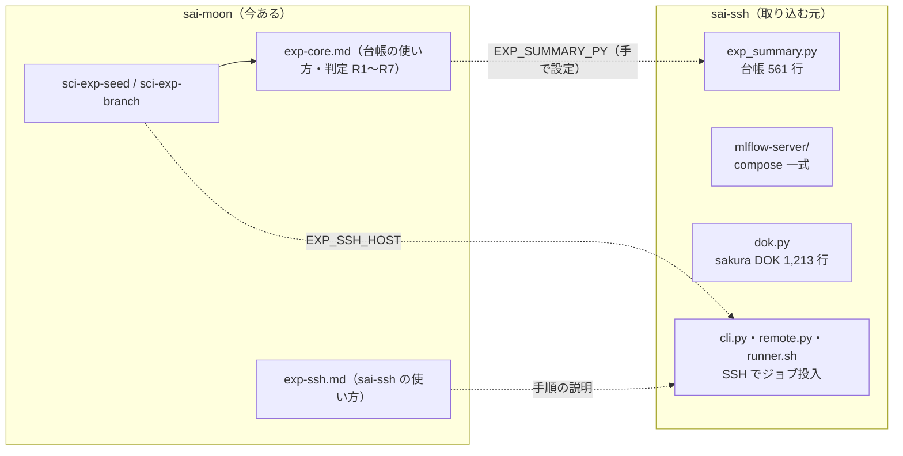
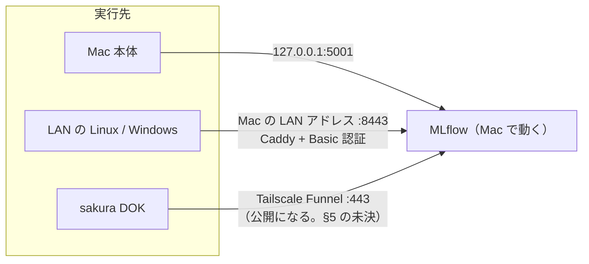

# 設計案: 実験ループを sai-moon だけで回す（実行先の部品化と sai-ssh の取り込み）

**状態**: 案（未着手。承認後に実装する）
**作成日**: 2026-09-29
**目的**: 「実験 → 結果取得 → 再計画 → 実験」のループを、sai-ssh なしで sai-moon だけで回せるようにする。実験を実際に動かす PC は複数あり、増減するので、実行先を差し替え可能な部品にする。
**あわせてやること**: 台帳・mlflow-server・sakura 接続を sai-moon に取り込み、sai-ssh を archive する。

---

## 1. 要件

| # | 要件 |
|---|---|
| R1 | ループ（seed → branch → MLflow → 台帳 → 判定 → 次の seed）が、sai-ssh なしで動く |
| R2 | 実行先は 4 種類: Mac 本体 / LAN の Windows / LAN の Linux / クラウドの sakura。接続は**実行先ごとに個別に作る** |
| R3 | 実行先は増減する。**追加・削除がフォルダの出し入れだけで済む**こと（Rust や画面を直さない） |
| R4 | 結果の置き場は **MLflow だけ**（正本を増やさない）。実行先が違っても、台帳は同じ規則で読める |
| R5 | 依存を増やさない（標準ライブラリと、すでに使っている uv・MLflow だけ） |

---

## 2. 現状（取り込む元）



- sai-moon のコード（Rust・Python・TS）に sai-ssh を呼ぶ箇所はゼロ。つながりは block/template の**文章**と環境変数だけ。
- MLflow は今、Docker で動いている（`c_postgres`・`c_minio`・`c_mlflow`・`c_caddy`）。データは名前付きの volume（`mlflow-server_db_store` など）にある。

---

## 3. 設計

### 3.1 実行先（target）の契約

実行先は「**名前を持つフォルダ**」です。中に、決まった名前の実行ファイルを置きます。言語は問いません（shell でも Python でも）。

adapter は**実行ファイル 1 本**で、第 1 引数が動詞です（動詞ごとに別ファイルにしない。共通の処理を 1 か所に書けるため）。

| 動詞 | 役割 | 出力 |
|---|---|---|
| `run` | スクリプトを 1 本投入する | 1 行目に `job_id` |
| `status` | ジョブの状態を返す | JSON（`state` は `queued` / `running` / `done` / `failed` / `cancelled` / `lost`） |
| `logs` | ログの末尾を返す | 文字 |
| `cancel` | 中止する | — |
| `check` | 接続と前提を確かめる（任意） | 成功なら終了コード 0 |

- **`collect` は要りません。** スクリプトが MLflow に直接書くので、回収する物がありません（R4）。ログだけ `logs` で読めます。
- 状態の言葉は sai-ssh と同じにします（台帳・報告書の書き方を変えないため）。

### 3.2 置き場と探す順

```
<project>/.sai/exec/<target>/     ← プロジェクト用
~/.sai-moon/exec/<target>/        ← 利用者全体用（プロジェクトに無いとき）

<target>/
├── target.toml      ← 説明・種類・有効/無効・同時実行数・env（実行先ごとの環境変数）
└── adapter          ← 実行ファイル 1 本（`adapter run|status|logs|cancel|check`）
```

- 探す順は block・template と同じ（プロジェクト → 全体）。
- **追加**: フォルダを置く。**削除**: フォルダを消す、または `target.toml` の `enable = false`。
- `target.toml` の `env` は、`MLFLOW_TRACKING_URI` など**実行先ごとに違う値**を上書きするために使います。MLflow の場所は実行先で違うからです（§3.5）。

`target.toml` の例:

```toml
name = "lab-linux"
description = "研究室の Linux（GPU 2 枚）"
kind = "ssh"
enable = true
max_jobs = 2

[env]
MLFLOW_TRACKING_URI = "http://192.168.1.10:8443"
```

### 3.3 分配器（1 本のスクリプト）

エージェントは実行先の中身を知りません。分配器を呼ぶだけです。

```bash
uv run --no-project --python ">=3.11" python "$SAI_PROJECT_ROOT/.sai/tools/exp_exec.py" run <target> -- <command...>
uv run --no-project --python ">=3.11" python "$SAI_PROJECT_ROOT/.sai/tools/exp_exec.py" status <job_id> --json
```

分配器（標準ライブラリだけ・150 行ほど）がすること:

1. `<target>` のフォルダを探す（§3.2）。
2. `target.toml` の `env` を足して、`run` などを呼ぶ。
3. `job_id` と実行先の対応を `~/.sai-moon/exec/jobs/<job_id>.json` に残す（`status` で実行先を引くため）。
4. `list`（実行先の一覧と `check` の結果）を出す。

### 3.4 同梱する実行先（見本）

| 実行先 | 中身 | 由来 |
|---|---|---|
| `local`（Mac 本体） | 手元で `nohup` 起動し、状態をファイルに書く | 新規（`runner.sh` の考え方を流用） |
| `ssh`（Linux・Windows の OpenSSH） | ssh と rsync でコードを送り、`runner.sh` で動かす | sai-ssh の `remote.py`・`runner.sh`・`store.py` |
| `dok`（sakura の高火力 DOK） | コンテナのタスク登録と、終了時の cancel | sai-ssh の `dok.py` |
| `_example/` | 新しい実行先を作る雛形 | 新規 |

- `ssh` は Linux 用に作ります。**Windows は別の実行先として個別に作る**（R2）。OpenSSH で入れるなら `ssh` を写して直せますが、PowerShell 前提の違い（`bash -lc` が無いなど）があるので、実機で確かめてから決めます。
- 同梱は見本です。`sci init` が `.sai/exec/` に写し、有効にするかは利用者が決めます（初期値は `local` だけ有効）。

### 3.5 MLflow への到達（実行先ごとに違う）



- 「結果が MLflow に届く」ことがループの前提です。実行先の `target.toml` の `env` で、届く先を書き分けます。
- 認証の値（Basic 認証のパスワードなど）は `target.toml` に書かず、`~/.sai-moon/settings.json` の `env` に置きます（`.gitignore` の対象）。

### 3.6 台帳と block の場所

| 物 | 置き場 | 参照の仕方 |
|---|---|---|
| 台帳 `exp_summary.py` | `sai-sci/tools/` → `sci init` が `<project>/.sai/tools/` へ配る | `"$SAI_PROJECT_ROOT/.sai/tools/exp_summary.py"`（`SAI_PROJECT_ROOT` は sai-link が必ず入れる。**`EXP_SUMMARY_PY` は廃止**） |
| 分配器 `exp_exec.py` | 同上 | 同上 |
| 実行先の見本 | `sai-sci/exec/` → `.sai/exec/` へ配る | §3.2 |
| `exp-core` §8「実行場所の規則」 | 書き直す | 環境変数 `EXP_TARGET`（空なら `local`）で実行先を選び、分配器を呼ぶ |
| `exp-ssh.md` | `exp-run.md` に置き換える | 分配器の使い方だけを書く（実行先ごとの違いは書かない） |

---

## 4. 取り込みの手順（実装単位）

| 単位 | 内容 | 主な変更 | 確かめ方 |
|---|---|---|---|
| **U1** 台帳 | `exp_summary.py` とテストを `sai-sci/tools/` に移し、`sci init` が配るようにする。`exp-core` §5・seed・branch の `EXP_SUMMARY_PY` を置き換える | `sai-sci/`、`crates/sai-paper-cli/src/agent_assets.rs`（配布の 1 か所） | 台帳のテスト、`cargo test -p sai-paper-core`（型・ブロックの検査） |
| **U2** mlflow-server | `apps/mlflow-server/` に compose 一式を移す。**`.env` と `integration_test/.env` は移さない**。`docker-compose.yml` に `name: mlflow-server` を足す | `apps/mlflow-server/`、`AGENTS.md` のフォルダ表、`README.md` | `docker compose config`（起動しない）。volume 名が変わらないこと |
| **U3** 契約と分配器 | `exp_exec.py`・`local`・`_example/`・`exp-run.md`。`exp-core` §8 と branch を書き直す | `sai-sci/` | 分配器のテスト（`local` で 1 本流す）。旧 `EXP_SSH_HOST` の記述が残っていないこと |
| **U4** ssh | `remote.py`・`runner.sh`・`store.py` を `ssh` の実行先に組み直す。**collect が旧命令名 `sai-link` を呼ぶ問題は、collect ごと無くすので消える** | `sai-sci/exec/ssh/` | 実機の Linux で `check`・`run`・`status`・`logs`・`cancel` |
| **U5** sakura | `dok.py`・`SETUP.md`・`Dockerfile` を `dok` の実行先に組み直す。**実機の課金が出るので、確認は利用者と行う** | `sai-sci/exec/dok/` | `check`（課金なし）まで。`run` は利用者の承認後 |
| **U6** 文書 | `README.md`・`ARCHITECTURE.md`・`AGENTS.md`・`docs/system-map`・手順書 `tutorial.md` の該当箇所 | `docs/` ほか | 文書内の `sai-ssh` の残りを grep |
| **U7** archive | sai-ssh を `_archive` する（§5） | フォルダの移動 | 未 commit の変更 12 件の扱いを先に決める |

- 順序は U1 → U2 → U3 → U4 / U5（並列可）→ U6 → U7。
- U1〜U3 が済めば、**手元（Mac）だけでループが完結**します（R1）。U4 以降は実行先を増やす作業です。
- Windows の実行先は、この範囲に入れていません（実機の調査が先。§5）。

---

## 5. 未決（実装の前に決める）

| # | 未決 | 選択肢 | 推奨 |
|---|---|---|---|
| 1 | **sakura の MLflow への到達方法**。今の DOK の手順は **Tailscale Funnel で MLflow を公開インターネットに出す**（守りは Caddy の Basic 認証だけ）。sai-moon の README は「funnel を使わない」方針で、矛盾する | (a) 手順をそのまま取り込み、警告を書く。テストの間だけ開ける運用 (b) 別の経路を探す（DOK から Mac に届く VPN など） | (a)。sakura の実機で確かめてから (b) を検討 |
| 2 | **Windows の接続方法**（OpenSSH か、WSL か、別の方法か） | 実機で調べる | 個別に対応（R2）。U4 のあとに 1 台ぶん作る |
| 3 | **archive の形** | (a) `~/workdir/Sai/_archive/` へ移動 (b) その場に残して `ARCHIVED.md` と git tag (c) 取り込みだけして、archive は後で自分で行う | (a)。ただし移動の前に、未 commit の変更 12 件と、動いている MLflow の付け替え（下）を済ませる |
| 4 | **動いている MLflow の付け替え**。今の compose は `sai-ssh/mlflow-server` を作業場所として動いている。取り込み後の場所（`apps/mlflow-server`）から `docker compose up -d` し直すと、コンテナが作り直される（数秒〜数十秒止まる。**データは volume に残る**） | いつ付け替えるか | 利用者が実験を回していない時間に行う。私は自動で実行しない |
| 5 | **同時実行数**（`max_jobs`）の管理を分配器がやるか、実行先が持つか | 分配器（`queued` にして待たせる）／実行先（sai-ssh と同じ） | 実行先が持つ（分配器を単純に保つ） |

---

## 6. やらないこと（今回の範囲外）

- Web の画面で実行先を一覧・追加する（先に契約を固める。将来は「設定」画面の 4 つめの種類にできる）。
- sai-ssh の `hosts` / `setup` / `watch`（launchd による自動回収）。回収が要らないので不要。
- Windows の実行先（実機の調査が先）。
- MLflow を公開インターネットに出さない別経路の探索（未決 1 の (b)）。

---

## 7. リスク

| リスク | 対策 |
|---|---|
| **MLflow の履歴を失う** | compose の `name:` を固定して volume 名を保つ。付け替えの前に `docker volume ls` で確認する。バックアップを取ってから行う |
| **機密の混入**（`.env` に鍵・パスワード） | 移すファイルを一覧にして、`.env` 系は除く。取り込み後に `git status` と `grep` で鍵の文字列が無いことを確かめる |
| **実験ループの回帰**（`EXP_SUMMARY_PY` を消すと止まる） | U1 で `exp-core`・seed・branch を同時に直す。実験仕様書のひな形も確認する |
| **課金**（DOK） | `run` は利用者の承認後だけ。`check` は課金なし。終了時に必ず cancel する仕組みを維持する |
| **sai-ssh に未 commit の変更 12 件** | archive の前に、利用者が commit するか捨てるか決める |
